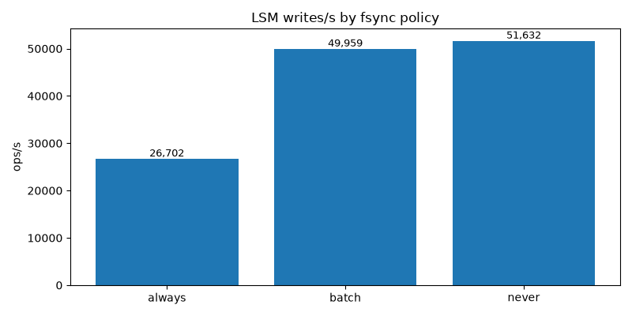
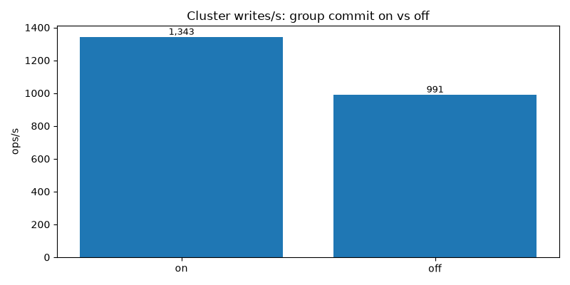
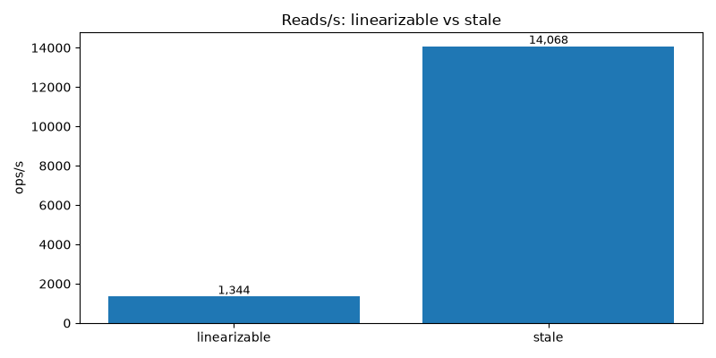
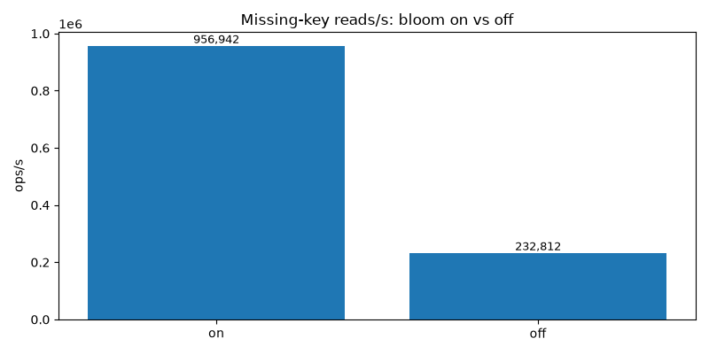
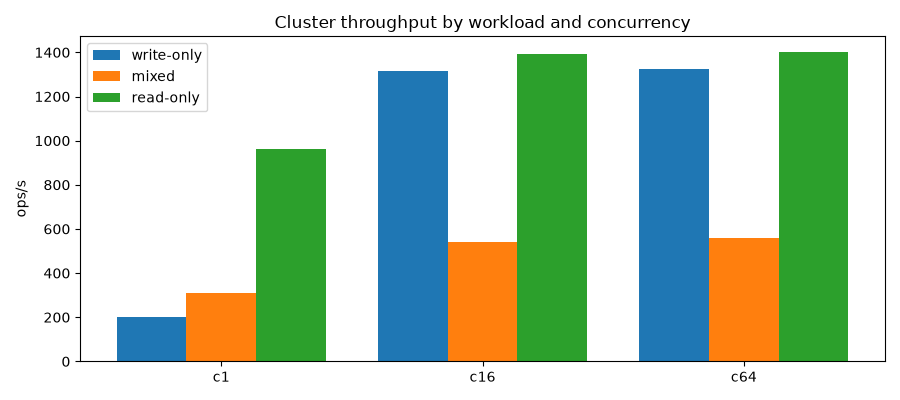

# Benchmarks

> Generated by `bench/report.py` from real runs. Reproduce with the commands in each section.

## Machine

- platform: `macOS-26.6.2-arm64-arm-64bit-Mach-O`
- python: `3.14.7`
- cpus: `10`
- storage: local APFS (macOS `fsync` without FULLSYNC is cheap; on Linux/ext4 expect a wider always-vs-batch gap)

## 1. Single-node LSM: fsync policy (write-only, 128B, 8s)

`python bench/run_bench.py --suite lsm-fsync`

| fsync | ops/s | p50 ms | p95 ms | p99 ms |
| --- | --- | --- | --- | --- |
| always | 26701.9 | 0.033 | 0.04 | 0.045 |
| batch | 49959.1 | 0.015 | 0.017 | 0.039 |
| never | 51632.5 | 0.015 | 0.017 | 0.035 |

## 2. 3-node cluster: group commit (write-only 128B, 16 clients, 10s)

`python bench/run_bench.py --suite cluster-batch`

| batching | ops/s | p50 ms | p95 ms | p99 ms |
| --- | --- | --- | --- | --- |
| True | 1342.6 | 11.676 | 13.492 | 14.751 |
| False | 991.0 | 15.812 | 19.959 | 23.424 |

## 3. Reads: ReadIndex vs stale (read-only 128B, 16 clients, 10s)

`python bench/run_bench.py --suite reads`

| mode | ops/s | p50 ms | p95 ms | p99 ms |
| --- | --- | --- | --- | --- |
| linearizable | 1344.2 | 10.422 | 17.436 | 45.789 |
| stale | 14068.4 | 1.099 | 1.312 | 2.379 |

## 4. Bloom filter: missing-key reads (20k keys on SSTables, 8s)

`python bench/run_bench.py --suite bloom`

| bloom | ops/s | p50 ms | p95 ms | p99 ms |
| --- | --- | --- | --- | --- |
| True | 956942.2 | 0.001 | 0.002 | 0.002 |
| False | 232811.8 | 0.001 | 0.018 | 0.018 |

## Headline: 3-node cluster, workloads x concurrency (128B, 8s)

`python bench/run_bench.py --suite headline`

| workload | conc | ops/s | p50 ms | p95 ms | p99 ms |
| --- | --- | --- | --- | --- | --- |
| write_only-128B-c1 | 1 | 202.5 | 4.708 | 6.043 | 7.997 |
| write_only-128B-c16 | 16 | 1315.9 | 11.607 | 14.457 | 25.658 |
| write_only-128B-c64 | 64 | 1325.1 | 46.792 | 54.723 | 79.931 |
| mixed-128B-c1 | 1 | 309.4 | 3.086 | 5.725 | 8.21 |
| mixed-128B-c16 | 16 | 542.0 | 27.389 | 50.803 | 79.231 |
| mixed-128B-c64 | 64 | 557.1 | 112.487 | 151.451 | 207.447 |
| read_only-128B-c1 | 1 | 963.6 | 1.018 | 1.053 | 1.221 |
| read_only-128B-c16 | 16 | 1392.2 | 10.999 | 12.489 | 23.967 |
| read_only-128B-c64 | 64 | 1402.5 | 45.214 | 47.501 | 70.23 |
| write-only-4KiB-c16 | 16 | 695.1 | 20.528 | 36.836 | 54.619 |

4 KiB values (write-only, 16 clients): **695.1 ops/s** (p50 20.528ms, p99 54.619ms) -- payload-dominated, as expected.

## Notes and limits

- localhost, single machine: no real network; multi-machine numbers would be lower.
- fsync=always on this box is cheap (APFS); treat the LSM gap as a lower bound.
- The store saturates around ~1.3k writes/s here (raft log + LSM WAL + progress meta fsyncs per write); batching on/off moves it ~35%.
- Linearizable reads cost a heartbeat round (~10x stale at 16 clients).
- Bloom filters pay ~4x on missing-key reads over on-disk tables.
